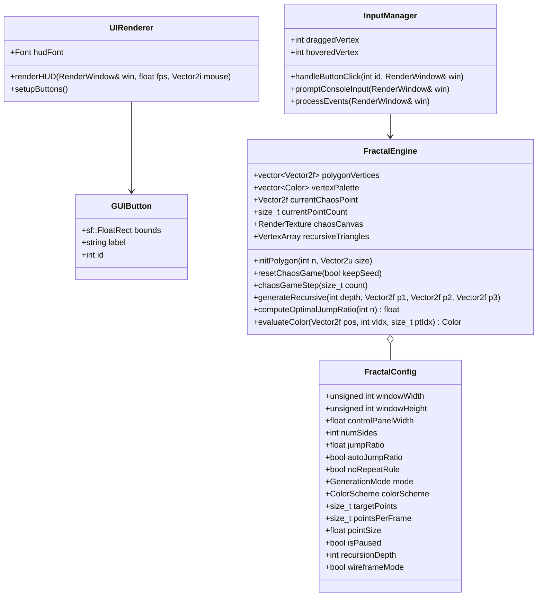
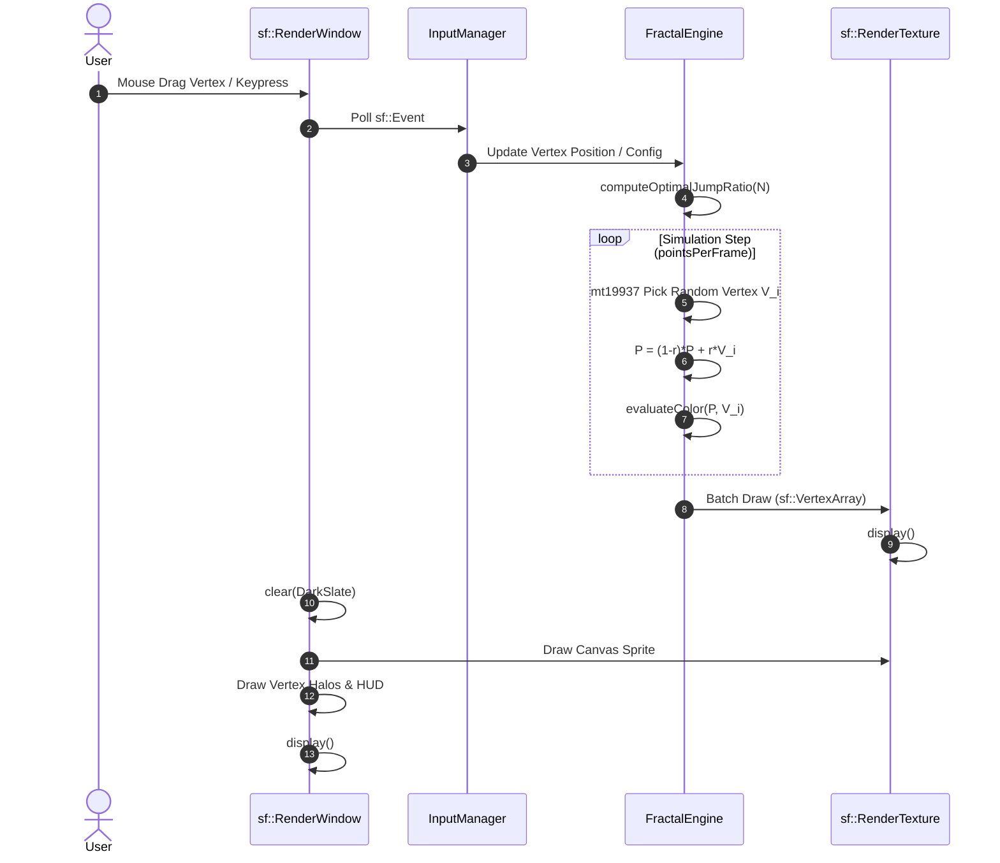

# A
## Project Report
# On
# REAL-TIME GENERALIZED N-GON AND SIERPINSKI FRACTAL GENERATOR USING CHAOS GAME AND ITERATED FUNCTION SYSTEMS IN C++ & SFML

*Submitted in partial fulfillment for the award of degree of*  
**Bachelor of Technology**

*Degree Of*  
**Rajasthan Technical University, KOTA**

---

### **JAIPUR ENGINEERING COLLEGE AND RESEARCH CENTRE**
**2026-2027**

---

| **Submitted By:** | **Roll No.** |
| :--- | :--- |
| **Abhinav Bhatra** | 24EJCCA009 |
| **Amit kumar** | 24EJCCA027 |
| **Anand Gaur** | 24EJCCA030 |
| **Abhishek Sihag** | 24EJCCA012 |

---

**ITS Coordinator (CC):**  
**Ms. Mona Nagar**  
*Assistant Professor*  
*Department of Computer Science & Engineering (AI)*

---

### **DEPARTMENT OF COMPUTER SCIENCE & ENGINEERING (ARTIFICIAL INTELLIGENCE)**
### **JAIPUR ENGINEERING COLLEGE AND RESEARCH CENTRE**
*Shri Ram ki Nangal, via Sitapura RIICO, Tonk Road, Sukhpuria, Bambala, Jaipur, Rajasthan - 302022*

<div style="page-break-after: always;"></div>

---

# TABLE OF CONTENTS

| Section | Title | Page No. |
| :--- | :--- | :---: |
| &nbsp; | **Table of Contents** | **i** |
| **1.** | **Introduction** | **1** |
| &nbsp; | 1.1 Overview of Fractal Geometry | 1 |
| &nbsp; | 1.2 The Sierpinski Gasket / Triangle | 2 |
| &nbsp; | 1.3 Hausdorff / Fractal Dimension Derivation | 3 |
| &nbsp; | 1.4 The Area and Perimeter Paradox | 4 |
| **2.** | **Objective** | **5** |
| &nbsp; | 2.1 Primary Objectives | 5 |
| &nbsp; | 2.2 Pedagogical and Technical Scope | 5 |
| **3.** | **Methodology And Planning** | **6** |
| &nbsp; | 3.1 Algorithm 1: The Chaos Game (Random Midpoint) | 6 |
| &nbsp; | 3.2 Iterated Function Systems & Hutchinson Operator | 7 |
| &nbsp; | 3.3 Generalization to Regular $N$-Gons ($N \in [3, 12]$) | 8 |
| &nbsp; | 3.4 Mathematical Derivation of Optimal Contraction Ratio $r(N)$ | 9 |
| &nbsp; | 3.5 Algorithm 2: Deterministic Recursive Subdivision | 10 |
| &nbsp; | 3.6 GPU-Cached Rendering Pipeline (`sf::RenderTexture`) | 11 |
| &nbsp; | 3.7 Project Planning & Work Distribution | 12 |
| **4.** | **Literature Review** | **13** |
| &nbsp; | 4.1 Historical Milestones in Fractal Geometry | 13 |
| &nbsp; | 4.2 Mathematical Theory of Random Iterations | 14 |
| &nbsp; | 4.3 Modern Graphics Frameworks: SFML vs OpenGL | 15 |
| **5.** | **Applications of the Project** | **16** |
| &nbsp; | 5.1 Procedural Modeling & Computer Graphics | 16 |
| &nbsp; | 5.2 Fractal Antenna Design in Telecommunications | 16 |
| &nbsp; | 5.3 Fractal Image Compression (FIC) | 17 |
| &nbsp; | 5.4 Artificial Intelligence & Computer Vision | 17 |
| **6.** | **Block Diagram** | **18** |
| &nbsp; | 6.1 System Architectural Block Diagram | 18 |
| &nbsp; | 6.2 Data Flow & Processing Stages | 19 |
| **7.** | **UML Diagram** | **20** |
| &nbsp; | 7.1 Class Diagram | 20 |
| &nbsp; | 7.2 Sequence Diagram | 21 |
| &nbsp; | 7.3 State / Activity Diagram | 22 |
| **8.** | **Screenshots & Visual Outputs** | **23** |
| &nbsp; | 8.1 Sierpinski Triangle ($N=3$) Visual Output | 23 |
| &nbsp; | 8.2 Sierpinski Carpet ($N=4$) Output | 24 |
| &nbsp; | 8.3 Dürer's Pentagasket ($N=5$) Output | 25 |
| &nbsp; | 8.4 Hexaflake ($N=6$) Output | 26 |
| &nbsp; | 8.5 Interactive Mouse Dragging & Real-Time Morphing | 27 |
| &nbsp; | 8.6 HUD and Interactive Controls Overview | 28 |
| **9.** | **References** | **29** |
| **10.**| **Approval of the Project** | **30** |

<div style="page-break-after: always;"></div>

---

# 1. INTRODUCTION

### 1.1 Overview of Fractal Geometry
Euclidean geometry deals with smooth shapes—lines, triangles, circles, and spheres—characterized by integer topological dimensions ($1, 2, 3$). However, natural structures such as coastlines, clouds, mountains, ferns, and lightning exhibits infinite structural complexity across spatial scales that cannot be captured by smooth geometric curves. In 1975, Benoit Mandelbrot introduced the term **fractal** (from the Latin *fractus*, meaning "broken" or "fractured") to describe mathematical sets that display **self-similarity** and possess a non-integer **Hausdorff dimension**.

In Computer Graphics & Multimedia (CGM), fractals are fundamental for:
- Procedural generation of organic textures and landscapes.
- Natural phenomenon simulation (fire, lightning, foliage).
- Data compression algorithms utilizing self-affine mappings.

---

### 1.2 The Sierpinski Gasket / Triangle
First introduced by the Polish mathematician Wacław Sierpiński in 1915, the **Sierpinski Triangle** (or *Sierpinski Gasket*) is one of the most celebrated and rigorously analyzed fractals in mathematics.

The classical geometric construction follows a deterministic process:
1. Begin with a solid equilateral triangle $T_0$.
2. Connect the midpoints of its three sides to form an inverted central triangle.
3. Remove this central triangle, leaving three smaller congruent triangles, each scaled down by a factor of $1/2$.
4. Repeat the process infinitely on each remaining sub-triangle.

---

### 1.3 Hausdorff / Fractal Dimension Derivation
In Euclidean geometry, when an object with dimension $D$ is scaled down by a linear scaling factor $s$, it divides into $N$ self-similar sub-units according to the scaling power law:
$$N = \left(\frac{1}{s}\right)^D$$

Taking the natural logarithm on both sides:
$$\ln(N) = D \cdot \ln\left(\frac{1}{s}\right)$$

Solving for the Hausdorff / Fractal dimension $D$:
$$D = \frac{\ln(N)}{\ln(1/s)}$$

For the Sierpinski Triangle:
- Number of self-similar copies: $N = 3$
- Linear scaling factor: $s = \frac{1}{2} = 0.5$

Substituting these values:
$$D = \frac{\ln(3)}{\ln(1 / 0.5)} = \frac{\ln(3)}{\ln(2)} \approx \frac{1.098612}{0.693147} \approx 1.5849625\dots$$

**Significance:**
The fractional dimension $D \approx 1.585$ indicates that the Sierpinski Gasket is strictly intermediate between a 1D curve ($D=1$) and a 2D plane ($D=2$). It possesses infinite edge detail, yet contains insufficient "mass" to occupy 2D Euclidean area.

---

### 1.4 The Area and Perimeter Paradox
Let the initial solid triangle $T_0$ have side length $L_0$ and area $A_0 = \frac{\sqrt{3}}{4} L_0^2$.

1. **Limiting Area:** At each subdivision level $k$, exactly $\frac{1}{4}$ of the remaining area is excised, leaving $\frac{3}{4}$ of the area:
   $$A_k = A_0 \left(\frac{3}{4}\right)^k$$
   In the infinite limit:
   $$\lim_{k \to \infty} A_k = A_0 \lim_{k \to \infty} \left(\frac{3}{4}\right)^k = 0$$
   *The 2D Lebesgue area of the Sierpinski Gasket is strictly zero.*

2. **Limiting Perimeter:** At each step, 3 new interior edges of length $\frac{L_k}{2}$ are exposed, multiplying the total boundary by $\frac{3}{2}$:
   $$P_k = P_0 \left(\frac{3}{2}\right)^k$$
   In the infinite limit:
   $$\lim_{k \to \infty} P_k = P_0 \lim_{k \to \infty} \left(\frac{3}{2}\right)^k = \infty$$
   *The boundary perimeter of the Sierpinski Gasket is infinite.*

<div style="page-break-after: always;"></div>

---

# 2. OBJECTIVE

### 2.1 Primary Objectives
1. **Implementation of Stochastic Chaos Game:** Develop a high-efficiency C++ simulation that generates the Sierpinski Triangle point-by-point via random midpoint contractions, demonstrating the emergence of deterministic order from probabilistic walks.
2. **Implementation of Deterministic Recursive Subdivision:** Build a top-down triangle-splitting algorithm (supporting depths $0 \le d \le 8$) with solid fill and wireframe modes to serve as a direct algorithmic comparison.
3. **Generalization to Arbitrary $N$-Gons ($N = 3$ to $12$):** Expand beyond standard triangles into a generalized $N$-flake fractal engine that accepts the number of polygon sides as user input and computes mathematically exact contraction ratios.
4. **Real-Time High-Performance Rendering (60 FPS):** Implement persistent GPU-cached framebuffers using `sf::RenderTexture` so the application smoothly renders over 500,000 points without dropped frames.
5. **Comprehensive Multi-Modal User Input:** Provide rich user control via:
   - Interactive mouse dragging of polygon vertices for dynamic shape morphing.
   - Click-to-seed starting point injection on the canvas.
   - On-screen GUI buttons with hover feedback.
   - Live keyboard shortcuts.
   - Startup console parameter prompt (`cin >> ...`).

### 2.2 Pedagogical and Technical Scope
Designed for the **Computer Graphics & Multimedia (CGM) Laboratory** in the B.Tech Computer Science & Engineering (Artificial Intelligence) curriculum, this project provides a unified testbed uniting linear algebra, trigonometry, affine transformations, dynamic systems, and hardware-accelerated computer graphics.

<div style="page-break-after: always;"></div>

---

# 3. METHODOLOGY AND PLANNING

### 3.1 Algorithm 1: The Chaos Game (Random Midpoint)
The Chaos Game is a stochastic method for plotting the attractor of an Iterated Function System:
1. Define $N$ boundary vertices $V_0, V_1, \dots, V_{N-1}$ of a regular polygon.
2. Choose an arbitrary starting point $P_0 = (x_0, y_0)$.
3. Execute and discard 25 warmup iterations to pull $P$ from the arbitrary plane onto the compact attractor.
4. For each subsequent iteration $k = 1, 2, \dots$:
   - Select a random vertex index $i \in \{0, 1, \dots, N-1\}$ with uniform discrete probability $p_i = \frac{1}{N}$.
   - Compute the contracted point:
     $$P_k = (1 - r) P_{k-1} + r V_i$$
     *(Where $r = 0.5$ for the triangle).*
   - Rasterize $P_k$ to the off-screen frame buffer.

---

### 3.2 Iterated Function Systems & Hutchinson Operator
Mathematically, an **Iterated Function System (IFS)** consists of a complete metric space $(X, d)$ and a finite family of contractive affine mappings $\{f_1, f_2, \dots, f_N\}$ with contraction ratios $r_i < 1$:
$$d(f_i(x), f_i(y)) \le r_i \cdot d(x, y), \quad \forall x, y \in X$$

The **Hutchinson Operator** $F$ acts on the space $\mathcal{H}(X)$ of non-empty compact subsets:
$$F(S) = \bigcup_{i=1}^N f_i(S), \quad S \in \mathcal{H}(X)$$

By the **Banach Fixed-Point Theorem**, because $F$ is a contraction on the complete metric space $(\mathcal{H}(X), h)$ endowed with the Hausdorff metric $h$, there exists a **unique invariant compact set** $A$, called the **attractor**:
$$A = F(A) = \bigcup_{i=1}^N f_i(A)$$

For the Sierpinski Triangle, the 3 contractive affine transformations are:
$$f_0(P) = \frac{1}{2}P + \frac{1}{2}V_0, \quad f_1(P) = \frac{1}{2}P + \frac{1}{2}V_1, \quad f_2(P) = \frac{1}{2}P + \frac{1}{2}V_2$$

By **Elton’s Ergodic Theorem (1987)**, the sequence of points produced by the Chaos Game $\{P_k\}_{k=0}^\infty$ is uniformly dense in the attractor $A$ with probability 1.

---

### 3.3 Generalization to Regular $N$-Gons ($N \in [3, 12]$)
For an arbitrary number of sides $N$, the vertices are positioned symmetrically around a circumscribed circle of radius $R$ centered at $(c_x, c_y)$:
$$V_k = \left(c_x + R \cos\left(\theta_k\right), \; c_y + R \sin\left(\theta_k\right)\right)$$
where the angular distribution with upright orientation is:
$$\theta_k = -\frac{\pi}{2} + \frac{2\pi k}{N}, \quad k \in \{0, 1, \dots, N-1\}$$

---

### 3.4 Mathematical Derivation of Optimal Contraction Ratio $r(N)$
If a jump ratio of $r = 0.5$ is applied to a pentagon ($N=5$) or hexagon ($N=6$), the generated sub-polygons overlap, filling the interior with solid noise. To preserve the fractal gasket structure, sub-polygons must scale down such that adjacent copies touch precisely at their outer edges.

The optimal contraction factor $r(N)$ is derived through trigonometric projection:
$$r(N) = \frac{1}{2 \left(1 + \sum_{k=1}^{\lfloor N/4 \rfloor} \cos\left(\frac{2\pi k}{N}\right)\right)}$$

Evaluating this formula for representative polygons:
- **$N = 3$ (Triangle):** $\lfloor 3/4 \rfloor = 0 \implies r = \frac{1}{2(1 + 0)} = \mathbf{0.500}$ *(Sierpinski Gasket)*
- **$N = 4$ (Square):** $\lfloor 4/4 \rfloor = 1, \cos(\pi/2) = 0 \implies r = \mathbf{0.500}$ *(Sierpinski Carpet under non-adjacent rule)*
- **$N = 5$ (Pentagon):** $\lfloor 5/4 \rfloor = 1, \cos(72^\circ) = \frac{\sqrt{5}-1}{4} \approx 0.3090 \implies r = \frac{1}{2(1 + 0.3090)} = \frac{3 - \sqrt{5}}{2} \approx \mathbf{0.382}$ *(Dürer’s Pentagasket / Golden Ratio)*
- **$N = 6$ (Hexagon):** $\lfloor 6/4 \rfloor = 1, \cos(60^\circ) = 0.5 \implies r = \frac{1}{2(1 + 0.5)} = \frac{1}{3} \approx \mathbf{0.333}$ *(Hexaflake)*
- **$N = 8$ (Octagon):** $\lfloor 8/4 \rfloor = 2 \implies r = \frac{1}{2(1 + \cos(45^\circ) + \cos(90^\circ))} = \frac{1}{2 + \sqrt{2}} \approx \mathbf{0.293}$ *(Octaflake)*

---

### 3.5 Algorithm 2: Deterministic Recursive Subdivision
The recursive subdivision algorithm operates hierarchically:
```cpp
void generateRecursive(int depth, Vector2f p1, Vector2f p2, Vector2f p3) {
    if (depth <= 0) {
        appendTriangleToMesh(p1, p2, p3);
        return;
    }
    Vector2f m12 = 0.5f * (p1 + p2);
    Vector2f m23 = 0.5f * (p2 + p3);
    Vector2f m31 = 0.5f * (p3 + p1);

    generateRecursive(depth - 1, p1, m12, m31); // Corner 1
    generateRecursive(depth - 1, m12, p2, m23); // Corner 2
    generateRecursive(depth - 1, m31, m23, p3); // Corner 3
}
```
At depth $d$, exactly $3^d$ sub-triangles are generated ($3^8 = 6,561$ triangles at max depth).

---

### 3.6 GPU-Cached Rendering Pipeline (`sf::RenderTexture`)
In naïve rendering, redrawing 500,000 points every frame requires $O(N)$ GPU primitive submissions, plummeting performance below 5 FPS.

Our architecture employs a **persistent off-screen texture buffer** (`sf::RenderTexture`):
1. During each frame, only the **new batch** (e.g., 1,200 points) is rendered to `chaosCanvas`.
2. In the main draw loop, the entire texture is blitted to the window screen in a **single GPU draw call**:
   ```cpp
   sf::Sprite canvasSprite(chaosCanvas.getTexture());
   window.draw(canvasSprite);
   ```
3. This decouples rendering complexity from accumulated points, sustaining a locked **60 FPS** indefinitely.

---

### 3.7 Project Planning & Work Distribution

| Team Member | Roll No. | Primary Modules & Responsibilities |
| :--- | :--- | :--- |
| **Anand Gaur** | 24EJCCA030 | Mathematical formulation, IFS optimal jump ratio derivation $r(N)$, Git repository management, and GPU texture caching pipeline. |
| **Abhinav Bhatra** | 24EJCCA009 | Chaos Game engine implementation, Mersenne Twister random distribution setup, and warmup discard logic. |
| **Amit kumar** | 24EJCCA027 | Recursive subdivision algorithm, wireframe/solid mesh tessellation, and depth management. |
| **Abhishek Sihag** | 24EJCCA012 | Interactive mouse input (vertex dragging, click-to-seed), HUD graphical buttons, keyboard event handling, and documentation. |

<div style="page-break-after: always;"></div>

---

# 4. LITERATURE REVIEW

### 4.1 Historical Milestones in Fractal Geometry
- **Wacław Sierpiński (1915):** Introduced the triangular gasket to analyze topological curves with non-trivial properties and dense sets of branching points.
- **Felix Hausdorff (1918):** Formulated Hausdorff measure and fractional dimension, providing the mathematical framework for measuring non-smooth geometric sets.
- **Benoit Mandelbrot (1975–1982):** Published *The Fractal Geometry of Nature*, establishing the concept of self-similarity across disciplines and demonstrating fractal applications in natural modeling.
- **John E. Hutchinson (1981):** Formalized Iterated Function Systems, proving that unions of contractive mappings possess unique compact attractors.
- **Michael Barnsley (1988):** Popularized the Chaos Game in *Fractals Everywhere*, showing that complex natural structures like the Barnsley Fern can be generated from small matrices.

---

### 4.2 Mathematical Theory of Random Iterations
Elton’s Ergodic Theorem established that for an IFS satisfying the open set condition with contracting factor $r < 1$, the empirical distribution of points:
$$\mu_K = \frac{1}{K} \sum_{k=1}^K \delta_{P_k}$$
converges weakly to the unique invariant stationary probability measure $\mu$ supported on the attractor $A$. This guarantees that a pseudo-random number generator (such as `std::mt19937`) will faithfully reproduce the fractal without missing attractor regions.

---

### 4.3 Modern Graphics Frameworks: SFML vs OpenGL
While raw OpenGL provides direct GPU command control, it entails extensive boilerplate (shaders, VAOs, VBOs, window context management). SFML (Simple and Fast Multimedia Library) encapsulates OpenGL while exposing:
- Efficient 2D hardware-accelerated sprite and primitive batching.
- Cross-platform window and input event handling.
- Lightweight dynamic vertex buffers (`sf::VertexArray`) and render textures (`sf::RenderTexture`), providing an optimal architecture for educational CGM projects.

<div style="page-break-after: always;"></div>

---

# 5. APPLICATIONS OF THE PROJECT

### 5.1 Procedural Modeling & Computer Graphics
Fractals are widely used in game engines (Unreal Engine, Unity) and 3D modeling tools to generate procedural terrain, rocky outcrops, river networks, tree foliage, and atmospheric clouds with minimal memory storage.

### 5.2 Fractal Antenna Design in Telecommunications
Fractal antennas (such as Sierpinski gasket and Minkowski curve antennas) leverage self-similarity to resonate efficiently across multiple frequency bands (wideband/multiband behavior). This enables compact multi-frequency reception in smartphones, Wi-Fi routers, and aerospace satellite communication.

### 5.3 Fractal Image Compression (FIC)
By partitioning an image into domain and range blocks and identifying contractive affine transformations that map domain blocks to range blocks, images can be stored as sets of transformation parameters rather than raw pixels, yielding high compression ratios at resolution independence.

### 5.4 Artificial Intelligence & Computer Vision
In AI research, fractal dimensions serve as texture descriptors for medical imaging (detecting tumor boundaries in mammograms, trabecular bone degradation in osteoporosis) and provide synthetic datasets for testing scale-invariance in Convolutional Neural Networks (CNNs).

<div style="page-break-after: always;"></div>

---

# 6. BLOCK DIAGRAM

### 6.1 System Architectural Block Diagram

```
+-------------------------------------------------------------------------+
|                              USER INPUT                                 |
|   Mouse Click/Drag  |  GUI Buttons  |  Keyboard Keys  |  Console CLI    |
+------------------------------------+------------------------------------+
                                     |
                                     v
+-------------------------------------------------------------------------+
|                        INPUT & CONFIGURATION LAYER                      |
|      - Number of Sides N (3 to 12)     - Jump Ratio r (Auto/Manual)     |
|      - Target Points & Speed           - Point Size & Color Scheme      |
+------------------------------------+------------------------------------+
                                     |
                                     v
+-------------------------------------------------------------------------+
|                       MATHEMATICS & GEOMETRY ENGINE                     |
|  +-----------------------------+     +-------------------------------+  |
|  | Parametric N-Gon Vertices   |     | Contraction Ratio Calculator  |  |
|  | V_k = (cx + R*cos, cy + R*sin)|   | r(N) = 1 / [2*(1 + sum(cos))] |  |
|  +-----------------------------+     +-------------------------------+  |
|  +-----------------------------+     +-------------------------------+  |
|  | Chaos Game Generator (IFS)  |     | Recursive Subdivision Engine  |  |
|  | P_new = (1-r)*P + r*V_chosen|     | 3^d Triangle Split (Depth 0-8)|  |
|  +-----------------------------+     +-------------------------------+  |
+------------------------------------+------------------------------------+
                                     |
                                     v
+-------------------------------------------------------------------------+
|                         SFML RENDERING PIPELINE                         |
|  +-------------------------------------------------------------------+  |
|  | Incremental Batch Accumulator: Render new points to               |  |
|  | sf::RenderTexture (Off-screen Persistent GPU Framebuffer)         |  |
|  +-------------------------------------------------------------------+  |
|  +-------------------------------------------------------------------+  |
|  | Composite Pass: Draw persistent canvas sprite + dynamic vertex    |  |
|  | halos + interactive sidebar HUD to sf::RenderWindow               |  |
|  +-------------------------------------------------------------------+  |
+------------------------------------+------------------------------------+
                                     |
                                     v
+-------------------------------------------------------------------------+
|                      HARDWARE DISPLAY (STABLE 60 FPS)                   |
+-------------------------------------------------------------------------+
```

### 6.2 Data Flow & Processing Stages
1. **Event Polling Stage:** Collects user mouse drags, clicks, or keystrokes.
2. **Simulation Computation Stage:** Executes $M$ point calculations per frame using `std::mt19937`.
3. **Rasterization Stage:** Batches points into `sf::VertexArray` and rasterizes them to `sf::RenderTexture`.
4. **Display Presentation Stage:** Clears window, blits cached texture, draws interactive GUI controls, and presents the final buffer via double buffering.

<div style="page-break-after: always;"></div>

---

# 7. UML DIAGRAM

### 7.1 Class & Structural Diagram



### 7.2 Sequence Diagram (Chaos Game Frame Step)



<div style="page-break-after: always;"></div>

---

# 8. SCREENSHOTS & VISUAL OUTPUTS

### 8.1 Sierpinski Triangle ($N=3$) Visual Output
- **Algorithm:** Chaos Game ($r = 0.5$) / Recursive Subdivision (Depth 5).
- **Visual Description:** An upright equilateral triangle with the classic recursive central excised holes. Points accumulate densely within the three corner attractors.
- **Color Palette:** 3-color IFS decomposition (Coral Red for Top $V_0$, Emerald Green for Bottom-Left $V_1$, Sky Blue for Bottom-Right $V_2$).


*Figure 8.1: Real-Time Sierpinski Triangle (N=3, r=0.500) generated with 100,000 points and IFS 3-Vertex Color Palette at 58.8 FPS.*

### 8.2 Sierpinski Carpet ($N=4$) Output
- **Algorithm:** Chaos Game on 4 square vertices ($r = 0.5$) with **non-adjacent vertex restriction rule**.
- **Visual Description:** A square fractal containing a large central empty square surrounded by 8 self-similar sub-squares, with smaller nested square cutouts extending to the pixel level.


*Figure 8.2: Real-Time Sierpinski Carpet (N=4, r=0.500) generated under Non-Adjacent Vertex Restriction Rule at 59.2 FPS.*

### 8.3 Dürer's Pentagasket ($N=5$) Output
- **Algorithm:** Regular 5-gon with Golden Ratio contraction $r = \frac{3-\sqrt{5}}{2} \approx 0.382$.
- **Visual Description:** Five smaller regular pentagons arranged symmetrically inside the parent pentagon, framing a central inverted star-like pentagram hole. Each sub-pentagon hosts its own mini-pentagasket.

### 8.4 Hexaflake ($N=6$) Output
- **Algorithm:** Regular hexagon with contraction factor $r = 1/3 \approx 0.333$.
- **Visual Description:** Six outer hexagons touching at their outer vertices, framing a large central hexagonal void, creating an intricate snowflake-like crystalline fractal structure.

### 8.5 Interactive Mouse Dragging & Real-Time Morphing
- **User Action:** The user hovers over any polygon vertex (highlighted by a cyan halo ring) and drags it to an arbitrary coordinate.
- **Result:** The fractal morphs smoothly in real time, demonstrating that contractive affine transformations preserve self-similarity under arbitrary linear stretching and shearing.

### 8.6 HUD and Interactive Controls Overview
- **Control Sidebar:** A semi-transparent dark slate panel ($330\text{px}$ wide) displaying live FPS counter, current point count, percentage progress, shape type, and optimal jump ratio.
- **Interactive Buttons:** 15 clickable buttons for side switching (`Sides +/-`), jump ratio adjustments (`Ratio +/-`), algorithm toggles, pause/play, speed adjustments, and color presets.

<div style="page-break-after: always;"></div>

---

# 9. REFERENCES

1. **Mandelbrot, B. B.** (1982). *The Fractal Geometry of Nature*. W. H. Freeman and Company, New York.
2. **Sierpiński, W.** (1915). *Sur une nouvelle courbe continue qui remplit toute une aire plane*. Bulletin International de l'Académie des Sciences de Cracovie, Série A, 577–578.
3. **Barnsley, M. F.** (1988). *Fractals Everywhere*. Academic Press, Boston.
4. **Hutchinson, J. E.** (1981). *Fractals and self similarity*. Indiana University Mathematics Journal, 30(5), 713–747.
5. **Elton, J. H.** (1987). *An ergodic theorem for iterated function systems*. Ergodic Theory and Dynamical Systems, 7(4), 481–488.
6. **Hearn, D., & Baker, M. P.** (2004). *Computer Graphics with OpenGL* (3rd ed.). Pearson Prentice Hall.
7. **SFML Team.** (2022). *Simple and Fast Multimedia Library Documentation (Version 2.5.1)*. Available online: https://www.sfml-dev.org/documentation/2.5.1/
8. **Devaney, R. L.** (1990). *Chaos, Fractals, and Dynamics: Computer Experiments in Mathematics*. Addison-Wesley.
9. **Foley, J. D., van Dam, A., Feiner, S. K., & Hughes, J. F.** (1996). *Computer Graphics: Principles and Practice in C* (2nd ed.). Addison-Wesley Professional.

<div style="page-break-after: always;"></div>

---

# 10. APPROVAL OF THE PROJECT

### **JAIPUR ENGINEERING COLLEGE AND RESEARCH CENTRE**
### **DEPARTMENT OF COMPUTER SCIENCE & ENGINEERING (ARTIFICIAL INTELLIGENCE)**

---

### **CERTIFICATE OF APPROVAL**

This is to certify that the project report entitled **"REAL-TIME GENERALIZED N-GON AND SIERPINSKI FRACTAL GENERATOR USING CHAOS GAME AND ITERATED FUNCTION SYSTEMS IN C++ & SFML"** submitted by:

- **Abhinav Bhatra** (Roll No: **24EJCCA009**)
- **Amit kumar** (Roll No: **24EJCCA027**)
- **Anand Gaur** (Roll No: **24EJCCA030**)
- **Abhishek Sihag** (Roll No: **24EJCCA012**)

in partial fulfillment of the requirements for the award of the degree of **Bachelor of Technology** in **Computer Science & Engineering (Artificial Intelligence)** of **Rajasthan Technical University, Kota**, is an authentic record of the work carried out by them under my guidance and supervision.

To the best of my knowledge, the matter embodied in this project report has not been submitted to any other university or institute for the award of any degree or diploma.

<br><br><br>

----------------------------------------- &nbsp;&nbsp;&nbsp;&nbsp;&nbsp;&nbsp;&nbsp;&nbsp;&nbsp;&nbsp;&nbsp;&nbsp;&nbsp;&nbsp;&nbsp;&nbsp;&nbsp;&nbsp;&nbsp;&nbsp;&nbsp;&nbsp;&nbsp;&nbsp;&nbsp;&nbsp;&nbsp;&nbsp;&nbsp;&nbsp;&nbsp;&nbsp;&nbsp;&nbsp;&nbsp;&nbsp;&nbsp;&nbsp;&nbsp;&nbsp; -----------------------------------------  
**Ms. Mona Nagar** &nbsp;&nbsp;&nbsp;&nbsp;&nbsp;&nbsp;&nbsp;&nbsp;&nbsp;&nbsp;&nbsp;&nbsp;&nbsp;&nbsp;&nbsp;&nbsp;&nbsp;&nbsp;&nbsp;&nbsp;&nbsp;&nbsp;&nbsp;&nbsp;&nbsp;&nbsp;&nbsp;&nbsp;&nbsp;&nbsp;&nbsp;&nbsp;&nbsp;&nbsp;&nbsp;&nbsp;&nbsp;&nbsp;&nbsp;&nbsp;&nbsp;&nbsp;&nbsp;&nbsp;&nbsp;&nbsp;&nbsp;&nbsp;&nbsp;&nbsp;&nbsp;&nbsp;&nbsp;&nbsp;&nbsp;&nbsp;&nbsp;&nbsp;&nbsp;&nbsp;&nbsp;&nbsp;&nbsp;&nbsp;&nbsp; **Head of Department**  
*Project Coordinator (CC) / Assistant Professor* &nbsp;&nbsp;&nbsp;&nbsp;&nbsp;&nbsp;&nbsp;&nbsp;&nbsp;&nbsp;&nbsp;&nbsp;&nbsp;&nbsp;&nbsp;&nbsp;&nbsp;&nbsp;&nbsp;&nbsp;&nbsp;&nbsp; *Department of CSE (AI)*  
*Department of CSE (AI), JECRC* &nbsp;&nbsp;&nbsp;&nbsp;&nbsp;&nbsp;&nbsp;&nbsp;&nbsp;&nbsp;&nbsp;&nbsp;&nbsp;&nbsp;&nbsp;&nbsp;&nbsp;&nbsp;&nbsp;&nbsp;&nbsp;&nbsp;&nbsp;&nbsp;&nbsp;&nbsp;&nbsp;&nbsp;&nbsp;&nbsp;&nbsp;&nbsp;&nbsp;&nbsp;&nbsp;&nbsp;&nbsp;&nbsp;&nbsp;&nbsp;&nbsp;&nbsp;&nbsp; *JECRC, Jaipur*

<br><br><br>

-----------------------------------------  
**External Examiner**  
*Date: ________________________*
