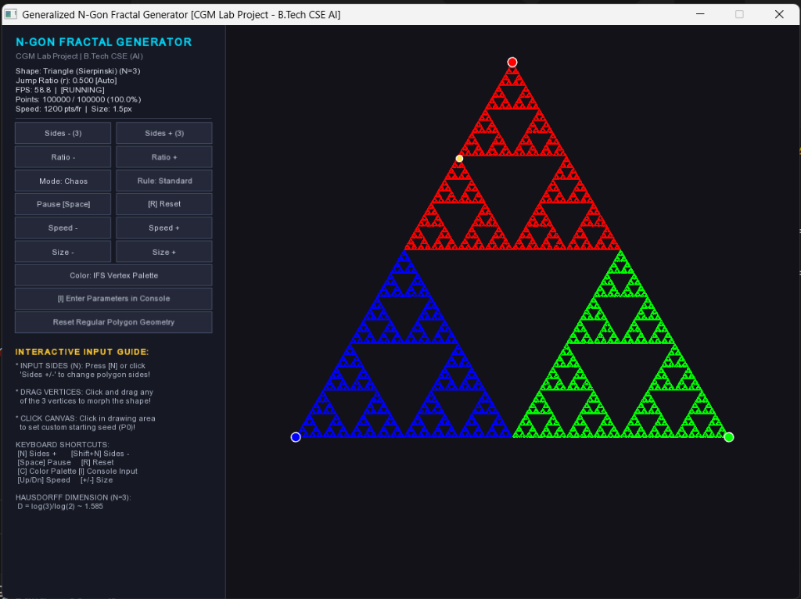
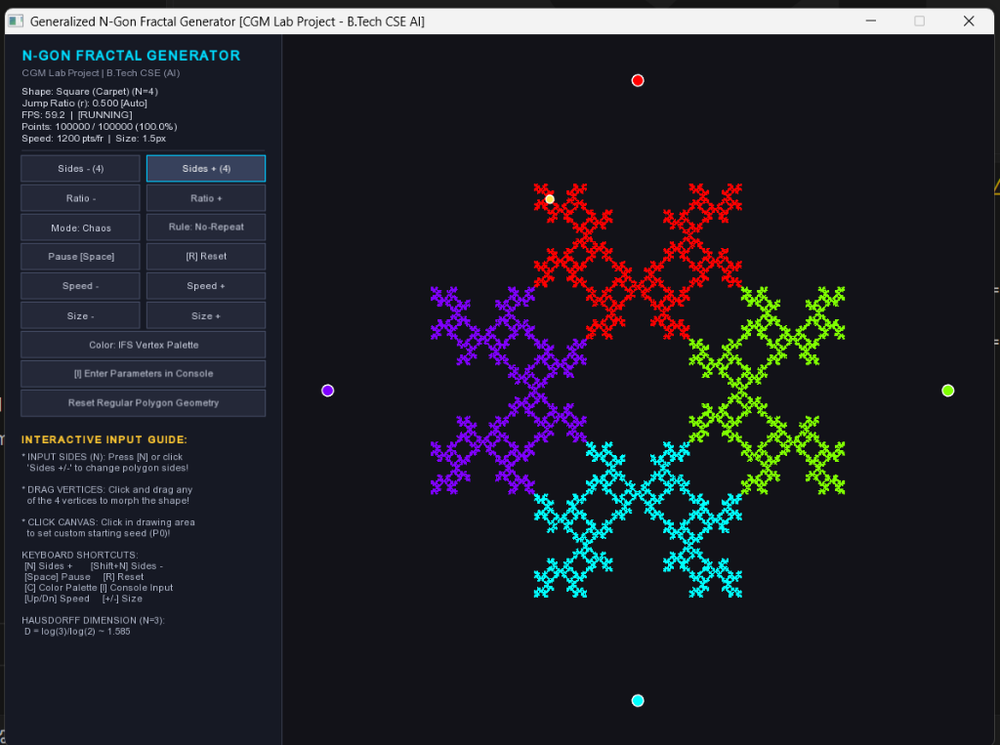

# A
## Project
# SYNOPSIS
### Of
# REAL-TIME GENERALIZED N-GON AND SIERPINSKI FRACTAL GENERATOR USING CHAOS GAME ALGORITHM IN C++ & SFML

*Submitted in partial fulfillment for the award of degree of*  
**Bachelor of Technology**

*Degree Of*  
**Rajasthan Technical University, KOTA**

---

### **JAIPUR ENGINEERING COLLEGE AND RESEARCH CENTRE**
**2026-2027**

---

| **Submitted By:** | **Roll No.** |
| :--- | :--- |
| **Abhinav Bhatra** | 24EJCCA009 |
| **Amit kumar** | 24EJCCA027 |
| **Anand Gaur** | 24EJCCA030 |
| **Abhishek Sihag** | 24EJCCA012 |

---

**ITS Coordinator (CC):**  
**Ms. Mona Nagar**  
*Assistant Professor*  
*Department of Computer Science & Engineering (AI)*

---

### **DEPARTMENT OF COMPUTER SCIENCE & ENGINEERING (ARTIFICIAL INTELLIGENCE)**
### **JAIPUR ENGINEERING COLLEGE AND RESEARCH CENTRE**
*Shri Ram ki Nangal, via Sitapura RIICO, Tonk Road, Sukhpuria, Bambala, Jaipur, Rajasthan - 302022*

---

# ABSTRACT

Fractal geometry plays an indispensable role in contemporary Computer Graphics and Multimedia (CGM), offering mathematical tools to simulate self-similar natural phenomena and procedural structures. The **Sierpinski Triangle** is an archetypal fractal exhibiting strict self-similarity, zero Lebesgue measure (area converging to zero), and infinite perimeter, characterized by a non-integer Hausdorff dimension of $D = \frac{\log 3}{\log 2} \approx 1.585$.

This project presents an interactive, high-performance C++ desktop application developed with the **Simple and Fast Multimedia Library (SFML 2.5+)** to simulate and visualize fractal generation through two fundamental paradigms:
1. **The Stochastic Chaos Game (Iterated Function Systems / Random Midpoint Method):** A bottom-up probabilistic algorithm where a wandering point iteratively contracts halfway toward randomly selected polygon vertices.
2. **Deterministic Recursive Subdivision:** A top-down geometric triangle-splitting method providing an algorithmic comparison.

Furthermore, this work extends the classic 3-vertex Sierpinski triangle into an **arbitrary $N$-sided regular polygon generator ($N = 3$ to $12$)**—commonly classified as *Generalized $N$-Flakes* (including the Sierpinski Carpet for $N=4$, Dürer’s Pentagasket for $N=5$, and the Hexaflake for $N=6$). To prevent geometric sub-shape overlap for higher-order polygons, the system dynamically calculates the mathematically optimal contraction ratio:
$$r(N) = \frac{1}{2 \left(1 + \sum_{k=1}^{\lfloor N/4 \rfloor} \cos\left(\frac{2\pi k}{N}\right)\right)}$$

The rendering engine leverages hardware-accelerated persistent framebuffers (`sf::RenderTexture`), guaranteeing sustained 60 FPS performance even when accumulating over 500,000 vertices. The application incorporates extensive user input modalities, including real-time mouse dragging of polygon vertices for dynamic shape deformation, interactive click-to-seed starting point placement, on-screen graphical buttons, keyboard hotkeys, and an interactive terminal parameter prompt.

---

# INTRODUCTION

### 1. Problem Statement
Traditional computer graphics curricula often introduce fractals through static equations or pre-rendered images, obscuring the dynamic process by which deterministic order emerges from stochastic iterations. Moreover, conventional implementations typically restrict students to the standard 3-vertex Sierpinski triangle, omitting the mathematical relationship between polygon vertex multiplicity ($N \ge 3$), contraction ratios ($r$), and Iterated Function Systems (IFS). Additionally, naïve point-by-point rendering frequently suffers from severe GPU frame-rate degradation as plotted point counts exceed $10^5$. 

This project addresses these challenges by developing a generalized, real-time interactive $N$-gon fractal generator that couples rigorous mathematical derivations with an optimized GPU-cached rendering pipeline.

---

### 2. Scope of the Project
The scope of this project encompasses:
- Implementation of both **Stochastic Chaos Game** and **Deterministic Recursive Subdivision** in modern C++.
- Generalization of the attractor geometry from an equilateral triangle ($N=3$) to regular $N$-gons ($N \in [3, 12]$) with automatic computation of optimal contraction ratios.
- Implementation of IFS restriction rules (such as non-adjacent vertex selection) to construct the Sierpinski Carpet for $N=4$.
- Real-time user interaction via mouse (vertex dragging, click-to-seed canvas), on-screen GUI HUD, and keyboard hotkeys.
- Console-based parameter injection enabling user configuration of polygon sides, target points, speed, and point scale.
- High-efficiency rendering utilizing off-screen `sf::RenderTexture` caching to maintain stable 60 FPS execution.

---

### 3. Technologies Used
- **Programming Language:** C++14 / C++17 (for type safety, STL random distributions, and raw compute efficiency)
- **Graphics API & Multimedia Framework:** SFML 2.5.1 (Simple and Fast Multimedia Library)
  - `sf::RenderWindow`: Display window and double-buffered frame presentation.
  - `sf::RenderTexture`: Off-screen persistent texture accumulator to prevent redraw bottlenecks.
  - `sf::VertexArray`: Batch GPU primitive submission (`sf::Points`, `sf::Triangles`, `sf::Lines`).
  - `sf::Event`: Low-latency mouse and keyboard event handling.
- **Random Number Generation:** Mersenne Twister Engine (`std::mt19937`) with uniform discrete distributions.
- **Build Systems:** CMake (v3.16+), GNU Make, MinGW g++ 6.3.0 / 7.3.0+.
- **Version Control:** Git & GitHub (`anandgaur0114/Sierpinski-Fractal-CGM`).

---

### 4. Methodology
1. **Mathematical Formulation:**
   - Represent regular $N$-gons parametrically on a bounding circle of radius $R$:
     $$V_k = \left(c_x + R \cos\left(\frac{2\pi k}{N} - \frac{\pi}{2}\right), \; c_y + R \sin\left(\frac{2\pi k}{N} - \frac{\pi}{2}\right)\right)$$
   - Define the affine contraction mapping: $P_{k+1} = (1 - r) P_k + r V_{\text{chosen}}$, where $r = r(N)$.
   - Warmup cycle: Execute and discard 25 initial iterations to allow the sequence to converge onto the compact attractor from any arbitrary starting coordinate.
2. **Architectural Pipeline:**
   - **Input Manager:** Polls mouse coordinates and button hits; handles real-time vertex translation and seed point injection.
   - **Fractal Generation Engine:** Iterates the random midpoint algorithm, dispatching batches of points per frame to maintain temporal continuity.
   - **Persistent Cache Blitter:** Only new points are rasterized onto `sf::RenderTexture`; the composited frame is drawn to the screen in a single GPU draw call.
   - **HUD & Overlay:** Renders interactive control buttons, coordinate markers, and live performance metrics (FPS, points count, progress).

---

### 5. Expected Outcome
- An intuitive desktop GUI displaying real-time emergence of fractals from random point walks.
- Smooth transition between polygon types ($N=3$ triangle, $N=4$ carpet, $N=5$ pentagasket, $N=6$ hexaflake, etc.).
- Immediate visual morphing of the fractal when corner vertices are dragged with the mouse.
- Zero frame-rate drops when rendering up to 500,000 points.
- A comprehensive educational platform demonstrating fractal geometry, Iterated Function Systems, and graphics optimization.

---

### 6. Applications of Project
- **Computer Graphics Education:** Intuitive laboratory demonstration tool for teaching affine transformations, fractals, and GPU caching.
- **Procedural Modeling & Terrain Generation:** Foundational algorithms for generating organic textures, procedural coastlines, and mountains in game engines.
- **Antenna Engineering:** Simulation of fractal antenna geometries (e.g., Sierpinski gasket antennas) that provide multiband resonance in telecommunications.
- **Data Compression:** Practical demonstration of Fractal Image Compression (FIC) based on IFS attractor theorem.
- **AI & Pattern Recognition:** Generating synthetic self-similar datasets for training computer vision models.

---

# CONCLUSIONS AND FUTURE ENHANCEMENTS

### Conclusions
The project successfully bridges theoretical mathematics and modern computer graphics engineering:
1. **Validation of Chaos Theory:** Proves that stochastic, non-deterministic random walks under contractive constraints converge strictly to deterministic, self-similar attractors governed by Hutchinson’s Theorem.
2. **Generalized Polyflake Framework:** Eliminates the classic limitation of hardcoded triangles by enabling arbitrary regular $N$-gon fractal generation with mathematically derived contraction ratios.
3. **High Performance via Persistent Buffering:** Demonstrates that off-screen render texture caching eliminates $O(N)$ redraw overhead, preserving an unwavering 60 FPS at 500,000+ points.
4. **Pedagogical Value:** Provides an interactive experimental testbed for B.Tech Computer Science & Engineering (AI) students in Computer Graphics & Multimedia coursework.

---

### Future Enhancements
1. **3D Fractal Extrusions (Sierpinski Tetrahedron & Menger Sponge):** Expanding the affine mapping framework from 2D Euclidean space ($\mathbb{R}^2$) to 3D space ($\mathbb{R}^3$) using OpenGL / modern compute shaders.
2. **GPU Acceleration via Compute Shaders:** Offloading point calculations from the CPU Mersenne Twister to parallel GPU compute shaders (HLSL/GLSL) to simulate $10^7$ points per second.
3. **Genetic Algorithm Optimization for Custom Attractors:** Applying AI/machine learning to automatically discover contraction matrices and probability weights for user-drawn target silhouettes.
4. **Audio-Reactive Fractal Visualizer:** Linking audio FFT frequencies to polygon deformation and color palette shifts for real-time multimedia installations.

---

### System Visual Outputs (From Software Execution)

  
  

*Figure: Real-time simulation outputs. Left: Sierpinski Triangle ($N=3$, $r=0.500$) with 100,000 points. Right: Sierpinski Carpet ($N=4$, $r=0.500$) with non-adjacent restriction rule at 60 FPS.*

---

# REFERENCES

1. **Mandelbrot, B. B.** (1982). *The Fractal Geometry of Nature*. W. H. Freeman and Company, New York.
2. **Sierpiński, W.** (1915). *Sur une nouvelle courbe continue qui remplit toute une aire plane*. Bulletin International de l'Académie des Sciences de Cracovie, Série A, 577–578.
3. **Barnsley, M. F.** (1988). *Fractals Everywhere*. Academic Press, Boston.
4. **Hutchinson, J. E.** (1981). *Fractals and self similarity*. Indiana University Mathematics Journal, 30(5), 713–747.
5. **Elton, J. H.** (1987). *An ergodic theorem for iterated function systems*. Ergodic Theory and Dynamical Systems, 7(4), 481–488.
6. **Hearn, D., & Baker, M. P.** (2004). *Computer Graphics with OpenGL* (3rd ed.). Pearson Prentice Hall.
7. **SFML Team.** (2022). *Simple and Fast Multimedia Library Documentation (Version 2.5.1)*. Available online: https://www.sfml-dev.org/documentation/2.5.1/
8. **Devaney, R. L.** (1990). *Chaos, Fractals, and Dynamics: Computer Experiments in Mathematics*. Addison-Wesley.
